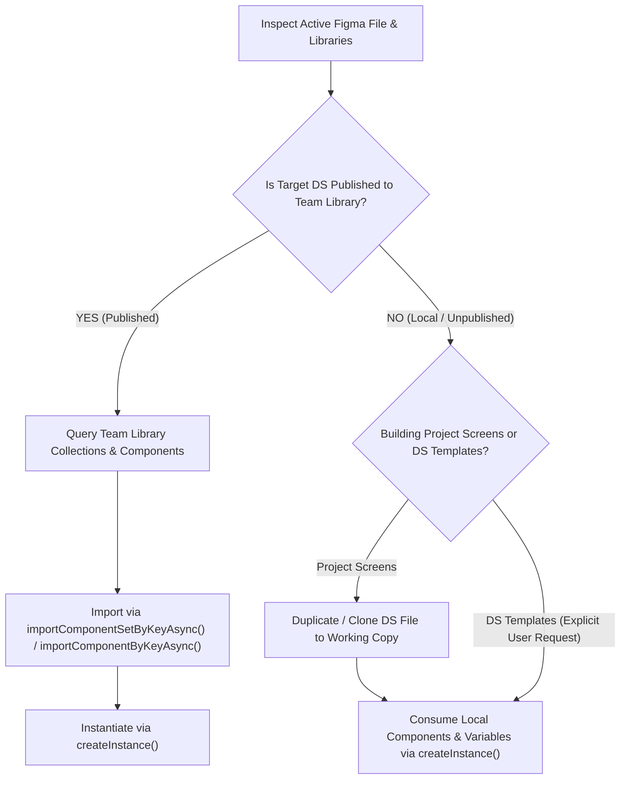

# Figma Design System Composer

This skill governs the end-to-end workflow for composing production-grade screens and flows in Figma using **any structured Design System**. It is **Design System agnostic** by default: never assume component names, node IDs, font families, or variable paths—always discover them dynamically from the active file or linked Team Library first.

---

## 1. Operating Principles

1. **Clarification First:** Never guess user intent or build speculative screens if the prompt context or target Design System is ambiguous. Ask clarifying questions first.
2. **Dynamic Library Discovery First (Strict Ban on Ad-Hoc Layers):** ALWAYS run a programmatic audit of the active file and/or linked Team Libraries BEFORE creating ANY frame, text, or component layer. This applies to **EVERY SINGLE COMPONENT** in the active Design System—without exception (inputs, fields, buttons, badges, cards, KPI cards, navigation bars, dialogs, drawers, sheets, accordions, tabs, breadcrumbs, tables, list items, avatars, progress bars, kbd, switches, checkboxes, toasts, alerts, empty states, and icons). If an element exists in the active Design System, you **MUST** instantiate it via `createInstance()`. Never draw raw frames to simulate components that already exist.
3. **File Isolation & Clone Strategy:** Never contaminate or build end-user project screens directly inside an unpublished master Design System file. Duplicate/clone the file first and build project screens inside the working copy (unless the user explicitly asks to add templates inside the DS file itself).
4. **Strict Instance Immutability:** An `InstanceNode` is an immutable black box. Never override its internal padding, gaps, corner radius, or structural fills. Custom layout styling belongs exclusively on **new transparent structural frames** created inside `SLOT` nodes.
5. **Slot-Based Dynamic Assembly:** Custom content and compound layouts inside shells, cards, tables, dialogs, drawers, and overlays are assembled strictly through nodes of type `SLOT`.
6. **Zero Hardcoded Values:** Every color, spacing, padding, gap, corner radius, text style, and elevation effect on new structural wrappers must bind dynamically to the active Design System's **Variables**, **Text Styles**, and **Effect Styles**.
7. **Universal Component-First Composition:** Raw `FrameNode`s are permitted ONLY as transparent structural layout wrappers (screen viewports, flex rows/columns, slot content wrappers) or compliant `*Overlay` scrim containers when the DS does not provide a dedicated overlay wrapper.
8. **Overlay & Scrim Integrity:** Preserve Auto Layout on the root screen. Overlays float via `absolute` positioning (or the active DS's native overlay mechanism) with full edge-to-edge scrim coverage and zero backdrop cutoff.
9. **Interactive Prototype Separation:** Static/responsive screen composition is governed by this skill (`figma-design-system-composer`), while variable-driven interactive prototyping and reaction chaining are governed by `figma-prototype-composer`.

---

## 2. Phase-by-Phase Execution Workflow

### Phase 1: Context & Requirement Clarification
Before touching the canvas, verify both prerequisites are clear:
1. **Screen Context:** What specific domain, screens, states (happy path, empty, loading/skeleton, error, overlay), and data metrics are required?
2. **Design System Target:** Which Figma Design System file or published Team Library should be consumed?

> [!IMPORTANT]
> **Trigger Clarification:** If the request is ambiguous (e.g. "buatkan dashboard" without specifying domain, metrics, or target Design System), pause and ask before writing canvas code.

---

### Phase 2: Publish Check & Universal Dynamic Library Discovery

Before creating any node, determine whether the target Design System is published or local, then run a dynamic audit script:



#### Step 2.1: Run Universal Dynamic Discovery Script (`figma_execute`)
Run this single discovery script on the active file to index **exact live names, IDs, properties, slots, descriptions, fonts, variables, and effect styles**—never rely on memorized IDs or naming conventions:

```javascript
// Universal Design System Discovery (100% DS-Agnostic)
for (const p of figma.root.children) await p.loadAsync();

// 1. Variable Collections, Modes & Token Catalog
const collections = [];
for (const col of await figma.variables.getLocalVariableCollectionsAsync()) {
  const vars = [];
  for (const id of col.variableIds) {
    const v = await figma.variables.getVariableByIdAsync(id);
    if (v) vars.push({ id: v.id, name: v.name, type: v.resolvedType });
  }
  collections.push({ id: col.id, name: col.name, modes: col.modes, count: vars.length, vars });
}

// 2. Local Text Styles & Effect Styles (auto-detects exact font families & shadows/rings)
const textStyles = (await figma.getLocalTextStylesAsync()).map(s => ({
  id: s.id, name: s.name, font: s.fontName, size: s.fontSize, desc: s.description
}));
const effectStyles = (await figma.getLocalEffectStylesAsync()).map(e => ({
  id: e.id, name: e.name, desc: e.description
}));

// 3. Component Sets (with Props, Native Slots & Author Usage Descriptions)
const componentSets = [];
const standaloneComponents = [];
for (const p of figma.root.children) {
  for (const n of p.findAll(x => x.type === 'COMPONENT_SET')) {
    componentSets.push({
      page: p.name,
      id: n.id,
      name: n.name,
      description: n.description || '',
      props: n.componentPropertyDefinitions,
      variants: n.children.slice(0, 6).map(c => c.name)
    });
  }
  for (const n of p.findAll(x => x.type === 'COMPONENT' && x.parent?.type !== 'COMPONENT_SET')) {
    standaloneComponents.push({ page: p.name, id: n.id, name: n.name });
  }
}

return {
  fileName: figma.root.name,
  pages: figma.root.children.map(p => ({ id: p.id, name: p.name })),
  collections: collections.map(c => ({ id: c.id, name: c.name, modes: c.modes, count: c.count })),
  textStyles,
  effectStyles,
  componentSetsCount: componentSets.length,
  componentSets,
  standaloneCount: standaloneComponents.length,
  standaloneSample: standaloneComponents.slice(0, 40)
};
```

- **Read Component `description` fields carefully:** Many Design Systems embed authoritative **Do/Don't** usage rules directly in component descriptions (e.g., when to use `Dialog` vs `AlertDialog` vs `Sheet`, whether `Toast` error requires `×`, or responsive substitutions like `Table` → `Item` on mobile). Follow them strictly.
- **Optional Library-Specific Quirks:** If discovery identifies a known library with special quirks (such as `Pillar-UI: Bento` or `Pillar-UI: Nexus`), consult [references/ds-quirks.md](references/ds-quirks.md) for supplementary edge-case notes.

> [!CAUTION]
> **ABSOLUTE BAN ON AD-HOC LAYERS & AD-HOC COMPONENTS:**
> 1. NEVER call `figma.createComponent()` or `figma.combineAsVariants()` to invent UI components inside project screens.
> 2. NEVER create raw `FrameNode`s with borders, fills, or text to simulate ANY UI element (fields, buttons, badges, cards, tabs, navbars, avatars, modals, dialogs, toasts, or skeletons) when a matching component exists in the discovered catalog.
> 3. Always import/instantiate library icons (`Icon/*` or Lucide/icon components)—never use raw emojis or hand-drawn shapes when an icon component exists.

---

### Phase 3: Screen Architecture & Shell Initialization

1. **Match the Active DS's Native Viewport & Modes:**
   - Use the viewport dimensions of the discovered layout shell (e.g., Desktop `1360×860` / `1440×900`, Mobile `390×844`).
   - If the discovered variable collections include theme modes (`Light` / `Dark`) or responsive modes (`Desktop` / `Mobile`), explicitly apply the intended modes via `screen.setExplicitVariableModeForCollection(collection, modeId)`.
2. **Instantiate the Master App Shell First:**
   - Locate the discovered desktop/mobile shell component (e.g., `AppLayout`, `MobileAppLayout`, `layout`, or equivalent) and append it to the root screen frame BEFORE setting `layoutSizingHorizontal = 'FILL'` and `layoutSizingVertical = 'FILL'`.
3. **Locate Native `SLOT` Zones Dynamically:**
   - Discover slots via `shellInst.findAll(n => n.type === 'SLOT')` (e.g., `Content`, `HeaderActions`, `Body`, `Items`, `Rows`) rather than assuming hardcoded names.

---

### Phase 4: Universal Implementation Contract & Golden Rules

#### Rule 0: Component-First Layer Creation Test
Before calling `figma.createFrame()`, ask: **"Does this UI element exist in the discovered Design System catalog?"**
- **YES →** MUST be an `InstanceNode` (`variant.createInstance()`).
- **NO (pure structural scaffolding: viewport, flex row/column, slot wrapper) →** Transparent Auto Layout `FrameNode` (`fills = []`, `clipsContent = false`, 100% bound to discovered spacing/radius variables).

#### Rule 1: Strict Instance Immutability & Responsive Adaptation
- **Do NOT mutate** an instance's internal padding, `itemSpacing`, `cornerRadius`, or structural strokes/fills.
- **DO configure** via official controls:
  - Sizing relative to parent: `layoutSizingHorizontal = 'FILL' | 'HUG'`, `layoutSizingVertical`.
  - **Responsive Min-Dimension Nullification:** If a library component carries a hardcoded `minWidth` or `minHeight` wider/taller than its flex/grid cell, explicitly clear `instance.minWidth = null` (or `minHeight = null`) before setting `FILL` to prevent horizontal/vertical overflow.
  - **Exposed Component Properties (`setProperties`):** Use the exact property keys discovered in Phase 2 (`TEXT`, `BOOLEAN`, `VARIANT`, `INSTANCE_SWAP`). Never embed fake text icons like `+` or `↗` into button labels—toggle the icon boolean + `INSTANCE_SWAP` instead.
- **Square / Circular Geometry Invariant:** For avatars, icon buttons, and status dots created in custom wrappers, ALWAYS set `primaryAxisSizingMode = 'FIXED'` and `counterAxisSizingMode = 'FIXED'` with equal `width === height` so Auto Layout never squishes circles/squares into ovals.

#### Rule 2: Safe Slot Hydration & Append-First Lifecycle
1. **Append-First Rule:** Always `parent.appendChild(node)` **BEFORE** setting `layoutSizingHorizontal = 'FILL'`, `layoutSizingVertical = 'FILL'`, or mutating nested slots/sublayers.
2. **Placeholder Handling in Native Slots:**
   - When hydrating a `SLOT` inside an `InstanceNode` that ships with default placeholder children, prefer hiding (`child.visible = false`) or cleanly removing direct placeholder children only when verified safe in the active Figma runtime—and always verify no stray placeholder cards/buttons remain in the rendered screenshot.

#### Rule 3: Universal Padding Deduplication (Zero Double-Padding)
Before placing a wrapper frame inside ANY slotted container (card, dialog, sheet, drawer, accordion, table, layout content):
1. Inspect the slot's native padding (`slot.paddingTop`, `paddingRight`, `paddingBottom`, `paddingLeft`).
2. If the slot already provides padding on an axis, set the inner wrapper's padding on that axis to `0` (bound to the DS's zero-spacing token) so padding never stacks doubly.

#### Rule 4: Horizontal Auto-Layout Height Guardrail (Anti-100px Bug)
`figma.createFrame()` initializes to `100×100px`. Setting `layoutMode = 'HORIZONTAL'` leaves `counterAxisSizingMode = 'FIXED'` (`height = 100px`).
- **MANDATORY:** On every new horizontal Auto Layout frame (headers, toolbars, action rows, badge rows), explicitly set `counterAxisSizingMode = 'AUTO'` (or `layoutSizingVertical = 'HUG'` after appending).

#### Rule 5: Zero Hardcoded Values — Dynamic Variable, Text Style & Effect Style Binding
- **Fonts:** Load exact fonts from the discovered `LocalTextStyles` (e.g., `Inter`, `JetBrains Mono`, `Geist`)—never hardcode an unchecked font family.
- **Colors:** Bind fills/strokes via `figma.variables.setBoundVariableForPaint({ type: 'SOLID', color: fallbackRgb }, 'color', varObj)`.
  - **Translucent Surface Caveat (Scrims & Frosted Glass):** In Figma, binding an opaque (`a = 1`) COLOR variable to a `SOLID` paint or `GRADIENT_LINEAR` stop causes Figma's mode resolver to override `paint.opacity` back to `1` on mode-switched instances. For scrims and frosted glass surfaces, bind to **dedicated RGBA variables** (e.g., `surface-scrim`, `surface-glass`, `brand-glass`) whose alpha channel is stored inside the variable itself.
- **Spacing & Radius:** Bind `paddingTop/Right/Bottom/Left`, `itemSpacing`, and `topLeft/topRight/bottomLeft/bottomRightRadius` strictly to discovered float variables.
- **Text & Effects:** Prefer `await textNode.setTextStyleIdAsync(style.id)` and `await frame.setEffectStyleIdAsync(effectStyle.id)` from the discovered styles over manually reconstructing shadows or font specs.

#### Rule 6: Overlay, Drawer & Toast Placement Standards
- **Overlays (Dialogs, AlertDialogs, Sheets, Drawers):**
  - Keep Auto Layout intact on the root screen frame.
  - **Pattern A (Standalone Overlay Container — Preferred):** Append the DS's overlay component (e.g. `OverlayContainer`) or a single `*Overlay` frame directly under the root screen with `layoutPositioning = 'ABSOLUTE'`, `x = 0, y = 0`, matching full screen size, `opacity = 1`, scrim transparency ONLY on fill/RGBA token, and the popup (`*Content`) as a direct child positioned by `*Overlay`'s Auto Layout.
  - **Pattern B (Layout-Integrated Modal Prop):** If the active DS controls modals via a shell property (e.g. `has-modal`), clamp the shell's height to the modal viewport height (`layoutInst.minHeight`) so the backdrop scrim covers 100% edge-to-edge without cutoff.
- **Toasts:** Place directly inside the root screen with `layoutPositioning = 'ABSOLUTE'`, bottom-right (`24px` margin), no full-screen `ToastViewport` wrapper. Success/Info/Warning toasts omit `×`; Error toasts MUST include `×`.

---

## 3. Generic Dynamic Implementation Helper Pattern

```javascript
// 1. Build live lookup maps from the active file (zero hardcoded names/IDs)
const cols = await figma.variables.getLocalVariableCollectionsAsync();
const varByName = new Map();
for (const c of cols) {
  for (const id of c.variableIds) {
    const v = await figma.variables.getVariableByIdAsync(id);
    if (v) varByName.set(v.name, v);
  }
}
const textStyles = new Map((await figma.getLocalTextStylesAsync()).map(s => [s.name, s]));
const effectStyles = new Map((await figma.getLocalEffectStylesAsync()).map(e => [e.name, e]));

// 2. Load only the fonts actually used by the active Design System
const uniqueFonts = new Map();
for (const s of textStyles.values()) {
  uniqueFonts.set(`${s.fontName.family}::${s.fontName.style}`, s.fontName);
}
for (const font of uniqueFonts.values()) await figma.loadFontAsync(font);

// 3. Token binding helpers
function bindFill(node, varName, fallbackRgb = { r: 0.5, g: 0.5, b: 0.5 }) {
  const v = varByName.get(varName);
  if (!v) return;
  node.fills = [figma.variables.setBoundVariableForPaint({ type: 'SOLID', color: fallbackRgb }, 'color', v)];
}

function createWrapper(direction = 'VERTICAL', gapVarName = null) {
  const f = figma.createFrame();
  f.layoutMode = direction;
  f.primaryAxisSizingMode = 'AUTO';
  f.counterAxisSizingMode = 'AUTO'; // Prevents accidental 100px fixed height on HORIZONTAL frames
  f.fills = [];
  f.clipsContent = false;
  if (gapVarName && varByName.has(gapVarName)) {
    f.setBoundVariable('itemSpacing', varByName.get(gapVarName));
  }
  return f;
}

function getVariant(componentSet, matchObj) {
  return componentSet.children.find(
    c => c.type === 'COMPONENT' && Object.entries(matchObj).every(([k, v]) => c.name.includes(`${k}=${v}`))
  ) || componentSet.defaultVariant;
}
```

---

## 4. Phase 5: Verification & Visual Proofing

Before reporting completion, verify BOTH programmatically and visually:
1. **Programmatic Audit:**
   - Zero ad-hoc frames simulating existing library components.
   - Zero unbound padding, `itemSpacing`, or `cornerRadius` on newly created structural wrappers.
   - Zero child overflows (`child.width > parent.width + 1`), zero squished square/circular icons (`|w - h| > 0.5px`), and zero unintended `100px` frame heights.
   - Zero leftover placeholder text or placeholder slot children.
   - Mobile viewports (`≤430px`): primary touch targets meet minimum ergonomic height (`≥40–44px`).
2. **Visual Screenshot Proofing (Mandatory):**
   - Capture every created/modified screen via `figma_capture_screenshot` and inspect with `read_file`.
   - Confirm contrast (both Light & Dark if applicable), alignment, overlay scrim separation, and zero clipped text before declaring done.
