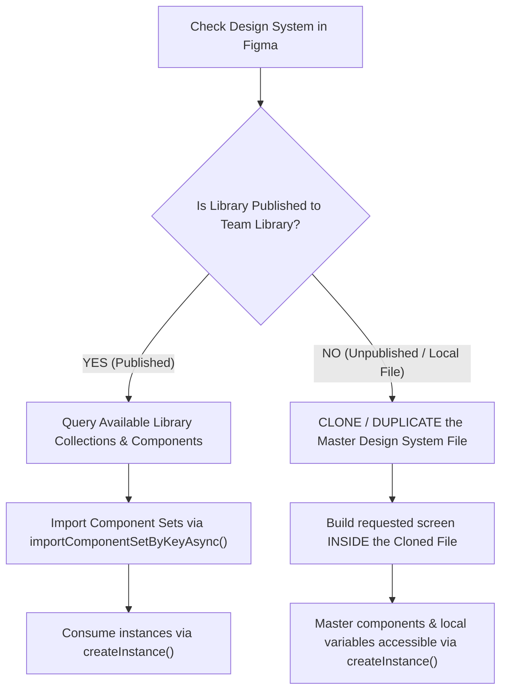

# Figma Design System Composer

This skill governs the end-to-end workflow for composing production-grade screens and flows in Figma using a structured Design System. It enforces strict component purity, zero hardcoded styles, and seamless slot-based assembly.

---

## 1. Operating Principles

1. **Clarification First:** Never guess user intent or build speculative screens if the prompt context or design system source is ambiguous. Ask clarifying questions first.
2. **Universal Active Library Audit First (Strict Ban on All Ad-Hoc Layers):** ALWAYS inspect active team libraries and existing design system components BEFORE creating ANY new layer, frame, or node on canvas. This applies to **EVERY SINGLE COMPONENT AND INSTANCE** available in Pillar-UI: Nexus or any active library—without exception (including all inputs, buttons, badges, cards, navigation items, dialogs, drawers, sheets, accordions, tabs, breadcrumbs, tables, bubbles, avatars, progress bars, kbd, switches, checkboxes, and icons). If an element or pattern exists anywhere in the active library, you MUST import and instantiate it via `createInstance()`. Never build custom frames or ad-hoc components to simulate elements that exist in the active design system.
3. **File Isolation & Clone Strategy:** Never contaminate or build end-user screens directly inside an unpublished master design system file. Clone the file first.
4. **Strict Instance Immutability:** An `InstanceNode` is an immutable black box. Never modify its native padding, gaps, radius, or fills. Custom layout styling belongs exclusively on **new structural layers** created inside slots.
5. **Slot-Based Dynamic Assembly:** Custom content and compound components are assembled exclusively through nodes of type `SLOT`.
6. **Zero Hardcoded Values:** Every single color, spacing, padding, gap, radius, and font size must be bound to Figma Variables (`color`, `size`, `primitive`, `typography`).
7. **Universal Component-First Composition:** Always construct screens using existing master components and instances across all library categories before creating raw structural frames. Raw frames are reserved strictly for layout containers (rows, columns, viewports) and slot content wrappers.
8. **Modal Viewport Clamping & Scrim Synchronization:** When activating modal/popup overlays on a layout instance (e.g. `has-modal = true`), the outer layout instance's height MUST be clamped to match the modal container's native viewport (`layoutInst.minHeight || 768`). This ensures 100% edge-to-edge backdrop coverage and prevents bottom backdrop cutoff or background content bleed.
9. **Interactive Prototype Separation:** Screen layout composition is governed by this skill (`figma-design-system-composer`), while all dynamic variable-bound state, comprehensive instance property scanning, multi-action reaction chaining, and prototype interactivity are strictly governed by the dedicated skill `figma-prototype-composer`.

---

## 2. Phase-by-Phase Execution Workflow

### Phase 1: Context & Requirement Clarification
When receiving a user request, evaluate whether both requirements are fulfilled:
1. **Screen Context:** What specific screen, dashboard, modal, or flow is being requested?
2. **Design System Target:** Which Figma design system file, library, or repository is being used?

> [!IMPORTANT]
> **Trigger Clarification:** If the user request is ambiguous (e.g. "buatkan dashboard", without specifying the domain, data metrics, or target design system), pause and ask the user for clarification before generating any code or canvas changes.

**Clarification Checklist:**
- What specific domain or workflow is this screen for (e.g., CRM Sales, E-Commerce Analytics, Fintech Billing)?
- What key metrics (KPIs), tables, actions, or views must be surfaced?
- Which Figma Design System file should be consumed?

---

### Phase 2: Design System Publish Status & Active Library Discovery

Before placing or writing ANY nodes, determine the publication state and audit all components in the active library:



#### Step 2.1: Universal Audit of Active Team Library Components
Before writing or generating ANY canvas layer, execute an inspection script to index ALL components and collections available in the active library:
1. **Variable Collections:** Query `figma.teamLibrary.getAvailableLibraryVariableCollectionsAsync()` to verify linked collections (`color`, `typography`, `size`, `primitive`).
2. **Comprehensive Component Discovery:** Map all required screen elements to their corresponding published master component sets or components in the active library:
   * **Form & Input Controls:**
     - Textfield & Textarea: `field` (`a952b44fd8f93585aca6e63c0d740e0bccf65061`) and nested `._field-base` (`557c7d83daf801ac89dedcaa4de6768b837135e2`)
     - Selection Controls: `combobox` (`110:1759`), `checkbox` (`db23c5882df25b3b58721cc35d6618cacc8e9575`), `radio-group` (`e48f7f2b1a9c1e0e8e97426e2e5055b8ef4ec53f`), `switch` (`5a0ea12b4e7df6ef8be30e38a2eef697e87a2a0d`), `input-otp` (`85:803`)
   * **Actions, Triggers & Menus:**
     - Buttons: `button` (`9661708117ef41f8bacbdbbc75e35adccad291f7`) and `._button-base` (`01b9955c3040547c55231a1d65f14689a87bc937`)
     - Context Menus: `context-menu` (`110:2334`), `context-menu-item` (`71:250`)
     - Keyboard Badges: `kbd` (`db09f64a5915f929121239bdd0a44f92ddf48f1e`), `kbd-group` (`99:509`)
   * **Containers, Cards & Data Presentation:**
     - Cards: `card` (`395cb28b245f6d3f645f4f624aaf6fab9ca5eac9`) and `card-item` (`f5bc06eb7f43e263a5e7be112bd70b8c11bd7c3f`)
     - Data Tables: `table-row` (`b4e613792ad55c12370b673cb1ad3b8b0ea2ccf8`), `table-cell` (`75a586c73e1136ebdf4125b3173dd9c46147e813`), `data-table-container` (`173:2193`)
     - Accordions: `accordion-group` (`100:1415`), `accordion-item` (`f505cbfdb173a75a85b87b6a0aba0cd8426744f9`)
     - Chat/Bubbles: `bubble` (`105:1013`), `bubble-item` (`7d581794ac0df9f72097b45205db107a83e81453`)
     - Empty State: `empty` (`81:526`)
   * **Feedback, Modals, Overlays & Sheets:**
     - Alerts & Toasts: `alert` (`45:12`), `toast` (`97:981`)
     - Dialogs: `dialog-container` (`11a396a93f31e374476a186072ba102fee5ce18d`), `alert-dialog-container` (`68c7d21c47743c5ebc635506263b41672c641e75`), `alert-dialog` (`49:109`)
     - Drawers & Sheets: `drawer-container` (`d78d05c3dcdb8d39553680e25e495ddbad5c7526`), `sheet-container` (`a67097da8367273c63295fa3b58dac8d76ec00f7`), `modal-container` (`163:2567`)
   * **Navigation, Layout & Wayfinding:**
     - Master Shell: `layout` (`127:2149`), `._header` (`127:2416`), `._sidebar` (`127:1921`), `._sidebar-logo` (`127:1872`), `sidebar-menu-item` (`e7498975624d03a3cd603c857de645269a60e0ce`)
     - Wayfinding: `breadcrumbs` (`119:2094`), `tab` (`116:3248`), `pagination-full` (`169:2718`), `filters-wrapper` (`180:2774`), `command-container` (`6dcdb690b42f067070198b87945000830be5b8f7`)
   * **Identity, Status & Indicators:**
     - User Identity: `avatar` (`ff901e96855b01d79d703ab4034057edb52a7249`), `avatar-group` (`100:1672`)
     - Status Indicators: `badge` (`9fe172ff11c9f543a64b1fc6a8c0d7b2ddc74101`), `progress-bar` (`94:537`)
   * **Vector Icons:**
     - Always use official published Lucide icon components from the library (`19:xxxx`), never raw text emoji or custom vectors when an icon exists.

> [!CAUTION]
> **ABSOLUTE BAN ON ALL AD-HOC LAYERS & AD-HOC COMPONENTS:**
> This rule is UNIVERSAL and applies to EVERY SINGLE COMPONENT in Pillar-UI: Nexus or any active library.
> 1. NEVER call `figma.createComponent()` or `figma.combineAsVariants()` to invent components in project screens.
> 2. NEVER create raw `FrameNode`s with borders, fills, or text to simulate ANY UI pattern (fields, buttons, badges, cards, tabs, navbars, avatars, modals, or dialogs).
> 3. If an element exists in the library, it **MUST be an `InstanceNode` imported from that library**.

#### Why Clone for Unpublished Libraries?
* In Figma, if a component library is **not published** to a Team Library, other Figma files cannot instantiate components from it (`figma.importComponentByKeyAsync` fails).
* To work with an unpublished design system without forcing a Team Library publish:
  1. **Do NOT build inside the master design system file.** The master file must remain clean (containing only primitive definitions, components, layouts, and documentation).
  2. **Clone the file** (duplicate the `.fig` file or duplicate the file in Figma / workspace).
  3. Work inside the **cloned working file** (e.g. `[Working] <Screen Name> (Nexus UI)`).
  4. In the cloned file, all master components (`127:2149`, `155:2034`, etc.) and local variable collections (`color`, `size`, `primitive`) are immediately accessible locally via `component.createInstance()` and `figma.variables.getLocalVariablesAsync()`.

---

### Phase 3: Screen Architecture & Layout Initialization

1. **Baseline Viewport:**
   - Standard Desktop: `1440×900px` or `1512×768px` (MacBook Pro baseline).
2. **Master Layout Shell First:**
   - Always instantiate the master `layout` component (in Nexus: `127:2149`).
   - The master layout provides the responsive shell: sidebar (260px), top header (64px), breadcrumbs, user profile, and theme toggles.
3. **Locate the Content Slot:**
   - Find the primary content insertion zone inside the layout instance:
     ```javascript
     const mainFrame = layoutInst.findOne(n => n.name === "main");
     const contentSlot = mainFrame.findOne(n => n.name === "content" && n.type === "SLOT");
     ```
   - All page-level containers and dashboard bodies are strictly appended to this `contentSlot`.

---

### Phase 4: Implementation Contract & Golden Rules

#### Rule 0: Universal Active Library Consumption (Strict Component Atomicity Rule)
Before writing ANY code that calls `figma.createFrame()`, ask: **"Does this UI element or pattern exist in the active design system library?"**

If the answer is YES, it **MUST be an `InstanceNode`**. Never create custom frames or ad-hoc components to simulate ANY element from the active library.

| UI Element Category | Permitted Node Type | Required Source in Active Library | Prohibited Anti-Pattern |
| :--- | :--- | :--- | :--- |
| **All Form & Input Controls**<br>*(Textfield, Textarea, OTP, Checkbox, Radio, Switch, Combobox)* | `InstanceNode` | Library `field`, `._field-base`, `input-otp`, `checkbox`, `radio-group`, `switch`, `combobox` | ❌ Custom `FrameNode` with border + text simulating input/box |
| **All Action & Trigger Controls**<br>*(Button, Button-Base, Shortcut KBD, Context Menu)* | `InstanceNode` | Library `button`, `._button-base`, `kbd`, `kbd-group`, `context-menu`, `context-menu-item` | ❌ Custom `FrameNode` with fill + text simulating button |
| **All Badges, Chips & Progress**<br>*(Status Pills, Tags, Badges, Progress Bars)* | `InstanceNode` | Library `badge`, `progress-bar` | ❌ Custom `FrameNode` with radius + text simulating badge |
| **All Cards, Containers & Panels**<br>*(Card, Card Item, Empty State, Bubble, Accordion)* | `InstanceNode` | Library `card`, `card-item`, `empty`, `bubble`, `bubble-item`, `accordion-group`, `accordion-item` | ❌ Custom `FrameNode` with border + shadow simulating card |
| **All Overlays, Modals & Drawers**<br>*(Dialogs, Modals, Drawers, Bottom Sheets, Alerts, Toasts)* | `InstanceNode` | Library `modal-container`, `dialog-container`, `alert-dialog`, `drawer-container`, `sheet-container`, `alert`, `toast` | ❌ Custom `FrameNode` simulating modal dialog or bottom sheet |
| **All Navigation & Wayfinding**<br>*(Sidebar Menu, Header, Breadcrumbs, Tabs, Pagination, Filters)* | `InstanceNode` | Library `layout`, `._header`, `._sidebar`, `sidebar-menu-item`, `breadcrumbs`, `tab`, `pagination-full`, `filters-wrapper`, `command-container` | ❌ Custom `FrameNode` simulating navbar, tab bar, or pagination |
| **All User Identity & Profiles**<br>*(Avatar, Avatar Group, Fallback)* | `InstanceNode` | Library `avatar`, `avatar-group` | ❌ Custom circle `FrameNode` with initials |
| **All Vector Icons**<br>*(System Icons, Navigation Icons, Status Icons)* | `InstanceNode` | Library Lucide icon components (`19:xxxx`) | ❌ Text emoji, raw SVG vectors, or ad-hoc shapes |
| **Pure Layout Scaffolding**<br>*(Screen Viewport, Flex Row/Col wrapper, Section grid)* | `FrameNode` | New Auto Layout frame with 100% token binding (`space/core/*`) | ❌ Hardcoded frame with unlinked pixels or inline styles |
| **Slot Content Wrapper**<br>*(Custom compound layout inside a component's SLOT)* | `FrameNode` | New Auto Layout frame appended to the `SLOT` | ❌ Injected directly into immutable instance sublayers |

* **Zero Ad-Hoc Components:** Never invoke `figma.createComponent()` or `figma.combineAsVariants()` in project files. Always query and consume the published library using `figma.importComponentSetByKeyAsync()` or `figma.importComponentByKeyAsync()`.
* **The Layer Creation Test:** A `FrameNode` is permitted ONLY as a structural container (viewport, section flex row/column, or slot wrapper). If a layer has semantic meaning, interactive states, or visual styling defined in the design system, it MUST be an `InstanceNode`.

#### Rule 1: Strict Instance Immutability & Responsive Adaptation
* **Instances are Black Boxes:** Never directly modify or override an instance's root or nested structural styling:
  - ❌ `instance.paddingTop`, `instance.paddingBottom`, `instance.paddingLeft`, `instance.paddingRight`
  - ❌ `instance.itemSpacing`, `instance.cornerRadius`, `instance.strokes`
  - ❌ Ad-hoc style or structural layout overrides on sub-instances.
* **What CAN and MUST be modified on an instance:**
  - ✅ Sizing mode relative to parent: `layoutSizingHorizontal = 'FILL' | 'HUG'`, `layoutSizingVertical`.
  - ✅ **Responsive Min/Max Dimension Nullification:** `instance.minWidth = null` or `instance.minHeight = null` when placed into multi-column grid cells or flex parents narrower/shorter than the master component's hardcoded minimum dimensions (e.g. `card-item`'s 384px min-width in a 285px card).
  - ✅ **Brand Color Adaptation:** When importing library components whose master defaults to foreign brand colors (e.g. corporate navy `#104D9C` in a Heat Orange `#FA5D19` workspace), deliberately adapt and override the instance's solid fills to match local brand canon.
  - ✅ Exposed Component Properties:
    - Text properties (`#label`) — **NEVER embed manual pseudo-icons like `+` or `↗` in text strings!**
    - Boolean visibility toggles (`showLeadingIcon = true`)
    - Variant selection (`variant = 'primary'`, `size = 'sm'`)
    - Instance swap properties (`icon = ...` via `INSTANCE_SWAP`)
* **Button & Icon Fidelity Rule:**
  - When a button requires an icon, modulate `._button-base` to `type = "leading-icon"` and perform an `INSTANCE_SWAP` using an official library icon component.
  - If a button requires no icon, set `type = "no-icon"`. Never leave default arrow icons (`arrow-up-right`) visible while typing text icons like `+`.
* **Avatar Geometry Invariant:**
  - ALWAYS use active library `avatar` instances (`57:48`).
  - Never allow an avatar to `HUG` text width into a squished oval (e.g. 18×30px). Dimensions must strictly be `FIXED` equal (`32×32px` or `28×28px`) with `cornerRadius = 9999px`.
* **Where Custom Layouts & Content Belong:**
  - Dynamic layouts and content belong exclusively on **new structural frames created inside nodes of type `SLOT`**.

#### Rule 2: Slot (`SLOT`) Manipulation & Lifecycle Mechanics
1. **Safe Slot Hydration (Never Call `.remove()` on Instance Sublayers):**
   - In dynamic-page Figma documents, calling `.remove()` on sublayers inside an `InstanceNode` slot corrupts Figma's internal node tree index, causing subsequent `findOne()` / `findAll()` traversals to crash with `Error: in get_name: The node (instance sublayer or table cell) with id "..." does not exist`.
   - **ALWAYS hide default placeholder children** instead of deleting them:
     ```javascript
     if (slot && slot.children) {
       for (const child of slot.children) {
         child.visible = false;
       }
     }
     ```
   - Then append your new content frame directly to the `slot`.
2. **Append-First Lifecycle Rule:**
   - Always append an `InstanceNode` or new frame to its canvas parent container **BEFORE** setting `layoutSizingHorizontal = 'FILL'` or mutating its slots/sublayers.
   - *Reason:* Setting `FILL` before appending throws runtime error `FILL can only be set on children of auto-layout frames`, and moving an instance after mutating slot children invalidates Figma's internal sublayer IDs (`I<parent>;<component>`).

#### Rule 3: Universal Padding Deduplication Contract (Zero Double-Padding on ALL Slotted Components)
Applies universally across **ALL slotted containers** (`card`, `dialog-container`, `modal-container`, `drawer-container`, `sheet-container`, `accordion-item`, `alert`, `toast`, `data-table-container`):
1. **Slot Padding Audit:** Before injecting any new Auto Layout wrapper frame into a component's `SLOT`, inspect the slot node's native padding (`slot.paddingTop`, `slot.paddingBottom`, `slot.paddingLeft`, `slot.paddingRight`).
2. **Single Responsibility & No Stacking:** If the parent container or slot already defines padding on an axis (e.g., `card-content` slot already has 24px vertical padding via `space/core/md` or 16px via `size='sm'`), any new wrapper frame injected inside that slot MUST set padding on that axis to `0px` (`space/core/none`). **NEVER add redundant padding on an axis that already has padding.**
3. **Card & Metric Card Invariant:**
   - For all dashboard KPI / metric stat cards, set `card.setProperties({ "size": "sm" })` (which gives native 16px vertical padding).
   - The injected wrapper (e.g. `kpi-content`) MUST set `paddingTop = 0` and `paddingBottom = 0`, keeping only horizontal padding (e.g. 16px–20px).
   - This ensures a sleek, compact card height of **~116px** (instead of bloated 164px+), preserving vital *above-the-fold* screen real estate.
4. **Strict Token Binding in Slotted Frames:** All text layers inside custom slotted frames must be bound to semantic color variables (`default/foreground`, `default/muted-foreground`, `default/subtle-foreground`) using `figma.variables.setBoundVariableForPaint`. Never leave raw unlinked hex fills.
5. **Uniform Spacing Target:** The sum of parent slot padding + inner wrapper padding on any side must equal the exact targeted token (e.g., 24px via `space/core/md` or 16px via `space/core/base`). Never allow a 2:1 inverted padding ratio (e.g., 40px vertical vs 20px horizontal).

#### Rule 4: Universal Min-Dimension Nullification on Responsive & Grid Instances
Applies universally across **ALL library instances placed inside flex containers, dialogs, drawers, or multi-column grids** (`card-item`, `field`, `combobox`, `dialog`, `drawer`, `sheet`, `table-cell`, `popover`):
1. Many master components in libraries carry hardcoded minimum dimensions (e.g. `card-item` has `minWidth: 384px`).
2. When inserting an instance into a container where the allocated slot width is smaller than the instance's `minWidth` (e.g. a 4-column card row where each card is ~283px wide), you MUST explicitly set:
   ```javascript
   instance.minWidth = null;
   instance.layoutSizingHorizontal = 'FILL';
   ```
3. This prevents hidden 100px+ sublayer overflows outside the parent boundary.

#### Rule 4b: Horizontal Auto-Layout Height Guardrail (Anti-100px Default Bug)
* **Root Cause:** When `figma.createFrame()` is called, Figma initializes frame dimensions to `100×100 px`. When setting `layoutMode = 'HORIZONTAL'`, Figma automatically sets `primaryAxisSizingMode = 'AUTO'` (HUG width), but keeps `counterAxisSizingMode = 'FIXED'` (FIXED height = 100px).
* **MANDATORY INVARIANT:** Every horizontal auto-layout frame created via `figma.createFrame()` (headers, toolbars, sub-nav tab bars, action rows, badge clusters) MUST be set to hug vertically:
  ```javascript
  const row = figma.createFrame();
  row.layoutMode = 'HORIZONTAL';
  parent.appendChild(row);
  row.layoutSizingVertical = 'HUG'; // or row.counterAxisSizingMode = 'AUTO'
  ```
* Omitting this causes containers to stubbornly retain an accidental 100px height, overflowing parent boundaries (e.g. stretching out of 56px headers or 42px tab bars).

#### Rule 5: Zero Hardcoded Values — 100% Variable Token Binding
* **Colors:** Bind via `figma.variables.setBoundVariableForPaint`:
  - Backgrounds: `default/background`, `muted/background`, `card/background`
  - Foregrounds/Text: `default/foreground`, `muted/foreground`, `primary/foreground`
  - Borders: `default/border`, weight bound to `border/sm` (1px)
* **Spacing & Gaps:** Bind via `node.setBoundVariable('itemSpacing', varObj)`:
  - `space/core/none` (0px) | `space/core/xs` (4px) | `space/core/sm` (8px) | `space/core/base` (16px) | `space/core/md` (24px) | `space/core/lg` (32px) | `space/core/xl` (40px)
* **Corner Radius:** Bind via `node.setBoundVariable('topLeftRadius', varObj)` etc.:
  - `radius/core/lg` (10px) standard for all buttons, cards, dialogs, form inputs.
* **Typography:** Preload `Geist` and bind `fontSize` to `font-size/core/*` (`h1` through `h6`, `base`, `sm`, `xs`, `2xs`).

#### Rule 6: Modal Viewport Height Clamping (`has-modal` Synchronization)
Applies whenever building or presenting a screen with an active modal, dialog, drawer, or sheet:
1. **The Backdrop Cutoff Problem:**
   * In desktop design systems like `Pillar-UI: Nexus`, the master `layout` has `minHeight: 768px`, and `modal-container` (including `drawer-container`, `dialog-container`, etc.) is structured for the standard `1512×768px` desktop viewport.
   * If a screen instance is manually stretched to `980px` or hugs long dashboard tables while `has-modal: true` is active, the modal scrim will only cover `768px`, leaving the bottom `212px` un-dimmed and overflowing.
2. **Mandatory Height Clamping:**
   * When configuring any layout instance with `has-modal: true`:
     ```javascript
     // Activate modal
     layoutInst.setProperties({ "has-modal#163:2": true });
     
     // CRITICAL: Clamp layout height to minHeight to prevent backdrop cutoff
     const targetH = layoutInst.minHeight || 768;
     layoutInst.resize(layoutInst.width, targetH);
     ```
3. **Background Content Confinement:**
   * Background content inside `content` slot must not force the outer layout to stretch. Ensure `main.clipsContent = true` or `main.layoutSizingVertical = 'FILL'` so that the background remains confined to the viewport behind the backdrop scrim.

#### Prototype State & Variable Binding Delegation
* For wiring interactive prototype state, variable-bound variant aliasing, comprehensive instance property scanning, and multi-action reaction chaining, consult the dedicated skill `figma-prototype-composer`.

---

## 3. Standard Implementation Template (JavaScript / Figma Bridge)

Below is the production-ready script pattern implementing these rules:

```javascript
// 1. Load Fonts
await figma.loadFontAsync({ family: "Inter", style: "Regular" });
await figma.loadFontAsync({ family: "Geist", style: "Regular" });
await figma.loadFontAsync({ family: "Geist", style: "Medium" });
await figma.loadFontAsync({ family: "Geist", style: "SemiBold" });
await figma.loadFontAsync({ family: "Geist", style: "Bold" });

// 2. Map Local Figma Variables
const allVars = await figma.variables.getLocalVariablesAsync();
const varMap = new Map();
allVars.forEach(v => varMap.set(v.name, v));

function bindFill(node, varName) {
  const v = varMap.get(varName);
  if (!v) return;
  const paint = figma.variables.setBoundVariableForPaint(
    { type: "SOLID", color: { r: 0.5, g: 0.5, b: 0.5 } },
    "color",
    v
  );
  node.fills = [paint];
}

function bindPadding(node, { top, right, bottom, left }) {
  if (top && varMap.has(top)) node.setBoundVariable("paddingTop", varMap.get(top));
  if (right && varMap.has(right)) node.setBoundVariable("paddingRight", varMap.get(right));
  if (bottom && varMap.has(bottom)) node.setBoundVariable("paddingBottom", varMap.get(bottom));
  if (left && varMap.has(left)) node.setBoundVariable("paddingLeft", varMap.get(left));
}

function bindSpacing(node, varName) {
  if (varName && varMap.has(varName)) node.setBoundVariable("itemSpacing", varMap.get(varName));
}

function createText(chars, fontStyle = "Regular", fontSizeVar = "font-size/core/base", colorVar = "default/foreground") {
  const t = figma.createText();
  t.fontName = { family: "Geist", style: fontStyle };
  t.characters = chars;
  if (fontSizeVar && varMap.has(fontSizeVar)) t.setBoundVariable("fontSize", varMap.get(fontSizeVar));
  if (colorVar && varMap.has(colorVar)) bindFill(t, colorVar);
  return t;
}

function createAutoLayout(direction = "VERTICAL") {
  const frame = figma.createFrame();
  frame.layoutMode = direction;
  frame.primaryAxisSizingMode = "AUTO";
  frame.counterAxisSizingMode = "AUTO";
  frame.fills = [];
  return frame;
}

// 3. Helper to Assemble Padded Cards (Respecting Instance Immutability)
const cardMaster = await figma.getNodeByIdAsync("155:2034"); // card: variant=custom
const cardItemMaster = await figma.getNodeByIdAsync("106:1213"); // card-item: type=card-content

function createPaddedCard(parentContainer, name) {
  // Append to parent container FIRST (Lifecycle Rule)
  const cardInst = cardMaster.createInstance();
  cardInst.name = name;
  parentContainer.appendChild(cardInst);
  cardInst.layoutSizingHorizontal = "FILL";

  const cardSlot = cardInst.findOne(n => n.name === "card-content" && n.type === "SLOT");
  // SAFE SLOT HYDRATION: Never call .remove() on instance sublayers (causes internal node index crash).
  if (cardSlot && cardSlot.children) {
    for (const ch of cardSlot.children) ch.visible = false;
  }

  // Insert card-item
  const itemInst = cardItemMaster.createInstance();
  cardSlot.appendChild(itemInst);
  // CRITICAL: Reset hardcoded minWidth: 384px to prevent horizontal overflow in multi-column grids!
  itemInst.minWidth = null;
  itemInst.layoutSizingHorizontal = "FILL";

  const innerSlot = itemInst.findOne(n => n.name === "card-content-container" && n.type === "SLOT");
  if (innerSlot && innerSlot.children) {
    for (const ch of innerSlot.children) ch.visible = false;
  }

  // Create NEW Frame inside slot for custom layout
  const contentWrapper = createAutoLayout("VERTICAL");
  contentWrapper.name = "card-inner-content";
  innerSlot.appendChild(contentWrapper);
  contentWrapper.layoutSizingHorizontal = "FILL";
  // CRITICAL: card-content slot already provides 24px vertical padding and card-item provides 24px horizontal padding.
  // Set vertical padding to 0px to prevent double-padding (80px bloat)!
  bindPadding(contentWrapper, {
    top: "space/core/none",
    bottom: "space/core/none"
  });

  return { cardInst, contentWrapper };
}

// 4. Helper to Instantiate Official Form Fields from Active Library
// Example: Pillar-UI: Nexus field component set key: a952b44fd8f93585aca6e63c0d740e0bccf65061
const fieldSet = await figma.importComponentSetByKeyAsync("a952b44fd8f93585aca6e63c0d740e0bccf65061");
const topLabelVariant = fieldSet.children.find(c => c.name === "type=top-label, state=default") || fieldSet.defaultVariant;

function createLibraryField(parentContainer, { label, value, helperText = null, mandatory = false, state = "idle" }) {
  const inst = topLabelVariant.createInstance();
  inst.name = "field-" + label;
  parentContainer.appendChild(inst);
  inst.layoutSizingHorizontal = "FILL";

  // Set field wrapper properties
  inst.setProperties({
    "label#85:24": label,
    "mandatory#85:59": !!mandatory,
    "has-helper#85:49": !!helperText,
    "helper-text#85:34": helperText || ""
  });

  // Configure nested ._field-base
  const fieldBase = inst.findOne(n => n.name === "._field-base" && n.type === "INSTANCE");
  if (fieldBase) {
    const baseProps = {};
    if (value) baseProps["text#85:0"] = value;
    if (state && state !== "idle") baseProps["state"] = state;
    fieldBase.setProperties(baseProps);
  }

  return inst;
}

// 5. Helper to Activate & Synchronize Modal Overlay
function activateModalWithViewportClamp(layoutInst, popupComponentId) {
  // 1. Activate has-modal property
  layoutInst.setProperties({ "has-modal#163:2": true });

  // 2. Synchronize layout height with minHeight (prevents 212px+ backdrop cutoff)
  const viewportH = layoutInst.minHeight || 768;
  layoutInst.resize(layoutInst.width, viewportH);

  // 3. Swap modal-container to requested popup
  const modalInst = layoutInst.children.find(c => c.name === "modal-container");
  if (modalInst && popupComponentId) {
    modalInst.setProperties({ "component#251:6": popupComponentId });
  }

  return modalInst;
}
```

---

## 4. Phase 5: Verification & Visual Proofing

1. **Data Verification:** Query generated nodes to verify that:
   - `instance.boundVariables` on sub-instances have not been altered.
   - All text, frames, and dividers have active variable aliases (`VARIABLE_ALIAS`).
   - Slot child counts match expected hierarchy (no leftover default nodes).
2. **Automated Geometry & Viewport Boundary Linter:**
   - **Viewport Height Check:** Ensure `screenNode.height <= 980` (or target baseline viewport height). Always lock `main.layoutSizingVertical = 'FILL'`.
   - **Modal Backdrop Coverage Check:** When `has-modal: true` is set on a layout instance, verify that `screenNode.height === modalInst.height` (e.g. exactly 768px). Flag any mismatch where screen height exceeds modal container height as a blocker.
   - **Child Boundary & Overflow Check:** Traverse all child nodes and verify that no child has `width > parent.width + 1` (zero horizontal overflow from hardcoded `minWidth`).
   - **Padding Deduplication Check:** Verify that total effective padding on all slotted cards/dialogs does not exceed the target design token (no stacked 80px double padding).
   - **Anti-100px Bottleneck Check:** Traverse all container frames and text wrappers to ensure no unintended `width = 100` or `height = 100` remains (clipping titles or over-height headers).
   - **Mobile Touch Ergonomics Check (WCAG 2.5.8):** For mobile viewports (<= 430px), ensure all primary interactive touch targets (action buttons, tabs) have a minimum height of `38px` (ideally `40px`).
3. **Visual Screenshot Proofing:**
   - Export screen via `screenNode.exportAsync({ format: 'PNG', constraint: { type: 'SCALE', value: 1 } })` or `figma_capture_screenshot`.
   - Save to artifact directory and inspect using `read_file`.
   - Verify alignment, contrast, padding consistency, and zero text/component clipping.

---

## 5. Universal Prompt Directive for Future Tasks

When delegating a task to an agent or collaborator, use this standard prompt structure:

```markdown
Konteks: [Jelaskan screen atau fitur yang ingin dibuat, misal: "Dashboard Analytics E-Commerce"]
Design System: [Nama file / URL Design System Figma, misal: "Pillar-UI: Nexus"]

Instruksi Pelaksanaan (Skill: figma-design-system-composer):
1. Verifikasi status publish Design System. Jika belum di-publish, buat/gunakan file clone dari design system tersebut agar dapat mengakses master instance tanpa memodifikasi file master.
2. Tanyakan klarifikasi jika konteks screen atau data belum spesifik.
3. Universal Active Library Audit First: Wajib audit semua komponen dan instance pada library aktif (Pillar-UI: Nexus atau library aktif lainnya) sebelum membuat layer/frame baru. SEMUA elemen UI tanpa terkecuali (field, input, button, badge, card, avatar, dialog, drawer, sheet, tab, breadcrumb, table, bubble, kbd, switch, checkbox, icon) WAJIB menggunakan instance dari library aktif. DILARANG KERAS membuat frame manual atau komponen ad-hoc untuk elemen yang sudah tersedia di library.
4. Strict Instance Immutability & Min-Dimension Responsiveness: Dilarang mengubah styling internal instance, tetapi WAJIB me-reset `minWidth = null` atau `minHeight = null` pada instance yang masuk ke kolom grid/kontainer yang lebih sempit dari batas minimum bawaan komponen (mencegah overflow 100px+).
5. Universal Padding Deduplication Contract: Dilarang menumpuk padding (double-padding). Jika slot parent sudah memiliki padding (misal 24px vertikal), layer di dalam slot wajib ber-padding 0px pada aksis tersebut.
6. Safe Slot Hydration: Sembunyikan default placeholder node dalam slot dengan `child.visible = false` (DILARANG KERAS memanggil `.remove()` pada sublayer instance agar tidak corrupt node index dan melempar error "node does not exist").
7. Zero Hardcoding: Wajib bind semua warna, gap, padding, font, dan radius ke Figma Variables lokal.
8. Component-First & Modal Clamping: Bangun screen di dalam master component 'layout'. Jika menggunakan popup overlay ('has-modal: true'), WAJIB menyamakan tinggi instance layout dengan `minHeight` (768px) agar backdrop scrim menutupi layar secara sempurna dari ujung ke ujung tanpa overflow latar belakang.
9. Interactive Prototype Delegation: Untuk interaktivitas prototype, scanning menyeluruh property instance, variable binding, dan chaining multi-action, wajib menggunakan skill 'figma-prototype-composer'.
10. Horizontal Height Hygiene: Selalu setel `layoutSizingVertical = 'HUG'` atau `counterAxisSizingMode = 'AUTO'` pada semua container horizontal untuk mencegah bug tinggi default 100px.
```
