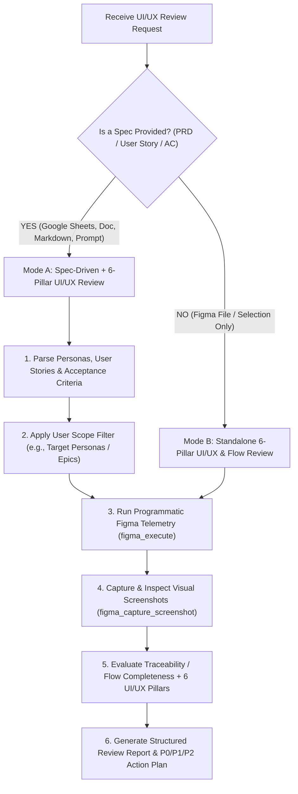

# Figma Senior UI/UX & Spec Reviewer

This skill governs the end-to-end workflow for conducting rigorous, evidence-backed **Senior UI/UX Design Reviews** in Figma. It is **100% project-agnostic** and adapts dynamically to any product domain, platform (Web, Mobile, Desktop, SaaS, Consumer), and specification format.

---

## 1. Operating Principles

1. **Project-Agnostic & Dynamically Scoped:** Never assume fixed User Stories, Personas, or Acceptance Criteria. Dynamically parse whatever specification is provided by the user, or run in **Standalone UI/UX Audit Mode** when no external spec is given. If the user restricts the review scope (e.g., to specific Personas, modules, pages, or sections), strictly filter all findings and metrics to that scope while noting any undocumented/out-of-scope screens separately.
2. **Dual-Layer Inspection (Programmatic Telemetry + Visual Verification):**
   - **Never rely solely on node tree JSON:** Raw node data misses optical contrast issues, broken/missing icon glyphs, cramped 2-line label wrapping, visual toast collisions, and semantic mismatches between a modal overlay and its background screen.
   - **Never rely solely on screenshots:** Visual inspection alone cannot quantify variable binding ratios, hardcoded hex sprawl, `lineHeight` unit mismatches (`AUTO` vs `%`), detached instances, or hidden layer bloat.
   - **Mandatory Combination:** Always run programmatic `figma_execute` telemetry first, then capture targeted screenshots via `figma_capture_screenshot` on key user flows, forms, error states, and modals.
3. **Read-Only, Non-Destructive Audit by Default:** Do not mutate, rename, move, or delete nodes in the designer's file during a review unless the user explicitly asks you to fix the issues. Switching `figma.currentPage` inside `figma_execute` to inspect a target page is permitted.
4. **Evidence-Backed Critique:** Every finding must cite concrete evidence: exact Figma frame/screen names (`Desktop - 24`, `Checkout - Step 2`), node IDs, quantitative metrics (e.g., *"93.6% of fills are bound to Variables; 6.4% are hardcoded hex"*), exact overflow coordinates (`x + width = 1530px > 1440px`), and—when a spec is provided—the corresponding Requirement / User Story / Acceptance Criteria ID.
5. **Component Override & Copy-Paste Vigilance:** Junior and mid-level designers frequently duplicate screens or instantiate master components without overriding default text, placeholders, helper messages, or button labels. Actively hunt for leaked component defaults (e.g., a Password or Phone input still showing a `"Full Name"` or `"Address"` placeholder, an `"Edit"` modal still showing an `"Add"` button, or a non-destructive status modal showing destructive `"Delete"` copy).
6. **Constructive Senior Mentorship Tone:** Frame feedback clearly, objectively, and constructively. Separate systemic root causes (e.g., a broken master component or missing token) from screen-level symptoms, and prioritize recommendations into **P0 (Critical Blockers)**, **P1 (Design System & UX Standardization)**, and **P2 (File Hygiene & Polish)**.

---

## 2. Review Modes

Determine which mode applies based on the user's request before starting:



- **Mode A — Spec-Driven Review (UI/UX + Requirement Traceability):**
  Used when the user provides a Google Sheets BA/PRD link, Markdown PRD, Jira/Linear ticket list, or inline User Stories & Acceptance Criteria. Evaluates 100% of in-scope Acceptance Criteria (`GIVEN` / `WHEN` / `THEN`, business rules, field validations, states) against the Figma screens, plus the full 6-Pillar UI/UX Audit.
- **Mode B — Standalone UI/UX Design Audit:**
  Used when the user asks to review a Figma file, page, or selection without an external spec. Evaluates end-to-end user flow completeness (happy path, empty state, loading state, validation error state, confirmation dialogs, feedback toasts) alongside the full 6-Pillar UI/UX Audit.

---

## 3. Phase-by-Phase Execution Workflow

### Phase 1: Context, Connection & Specification Discovery

#### Step 1.1: Verify Figma Connection & Target Scope
1. Check open Figma files and connection status using `figma_get_status` or `figma_list_open_files`.
2. Identify the target page(s), section(s), or user selection (`figma_get_selection`).
3. If the user wants to review a specific page (e.g., `UI`, `Design`, `Handoff`), switch to or target that page in subsequent scripts.

#### Step 1.2: Extract Requirements (Mode A Only)
If the user provides an external specification:
- **Google Sheets URL (`docs.google.com/spreadsheets/d/<id>`):**
  Use the `gsheets` skill/CLI to inspect all worksheet tabs (`sheets` command) and read relevant tabs (e.g., `Overview`, `Persona`, `User Story`, `Acceptance Criteria`, `Business Rules`).
  > [!TIP]
  > On Windows PowerShell, avoid raw `>` redirection for large JSON outputs as it defaults to `UTF-16LE`. Write output using UTF-8 encoding (`[System.IO.File]::WriteAllText($path, $output, [System.Text.UTF8Encoding]::new($false))`) before reading with `read_file`.
- **Markdown / Document / Prompt Spec:**
  Read and index every Persona, User Story (`US-XX`), and Acceptance Criterion (`AC-XX` or bulleted criteria).
- **Scope Filtering:**
  If the user specifies a scope boundary (e.g., *"only cover what belongs to the Personas in the User Story sheet"*), build an explicit allowlist of in-scope Personas, Stories, and corresponding Figma sections/screens. Any extra screens found in Figma that fall outside this allowlist must be excluded from core scoring and listed briefly under an **Out-of-Scope / Undocumented Screens** note.

---

### Phase 2: Programmatic Figma Telemetry (`figma_execute`)

Run automated diagnostic scripts via `figma_execute` to gather quantitative evidence across the target page or sections.

> [!IMPORTANT]
> **Figma Plugin API `dynamic-page` Compatibility:**
> Modern Figma plugins run with `documentAccess: "dynamic-page"`. **NEVER** access `node.mainComponent` synchronously—it throws an error. Always use `await node.getMainComponentAsync()` inside an `async` function.

#### Script 2.1: Page Inventory, Screen Mapping & File Hygiene Scanner
Use this script to map all sections and top-level screens, extract visible headers/titles for screen-to-story mapping, and detect canvas hygiene issues (default frame names, per-section coordinate overlaps, whitespace names, stray root vectors, and hidden layers):

```javascript
// Run via figma_execute
const targetPageName = null; // Set to e.g. "UI" or leave null to use figma.currentPage
const page = targetPageName
  ? figma.root.children.find(p => p.name.trim() === targetPageName) || figma.currentPage
  : figma.currentPage;
if (page !== figma.currentPage) await figma.setCurrentPageAsync(page);

const genericNameRegex = /^(Desktop|Frame|MacBook|iPhone|Android|Screen|Group|Section)\s*[-–]?\s*\d*$/i;
const sections = [];
const strayNodes = [];
let totalHiddenNodes = 0;

function scanScreen(frame, containerName) {
  const texts = [];
  let hiddenCount = 0;
  function walk(n) {
    if (!n.visible) {
      hiddenCount++;
      totalHiddenNodes++;
      return;
    }
    if (n.type === 'TEXT') {
      const chars = n.characters.trim();
      if (chars) texts.push({ text: chars.slice(0, 80), size: typeof n.fontSize === 'number' ? n.fontSize : 0 });
    }
    if ('children' in n) n.children.forEach(walk);
  }
  walk(frame);
  texts.sort((a, b) => b.size - a.size);
  return {
    id: frame.id,
    name: frame.name,
    container: containerName,
    isGenericName: genericNameRegex.test(frame.name.trim()),
    isWhitespaceName: frame.name.trim().length === 0,
    x: Math.round(frame.x),
    y: Math.round(frame.y),
    w: Math.round(frame.width),
    h: Math.round(frame.height),
    layoutMode: frame.layoutMode || 'NONE',
    hiddenLayers: hiddenCount,
    topHeadings: texts.slice(0, 6).map(t => t.text)
  };
}

function findOverlaps(screens) {
  const overlaps = [];
  for (let i = 0; i < screens.length; i++) {
    for (let j = i + 1; j < screens.length; j++) {
      const a = screens[i], b = screens[j];
      const overlapX = Math.max(0, Math.min(a.x + a.w, b.x + b.w) - Math.max(a.x, b.x));
      const overlapY = Math.max(0, Math.min(a.y + a.h, b.y + b.h) - Math.max(a.y, b.y));
      if (overlapX * overlapY > 100) {
        overlaps.push({ screenA: `${a.name} (${a.id})`, screenB: `${b.name} (${b.id})`, area: overlapX * overlapY });
      }
    }
  }
  return overlaps;
}

const rootScreens = [];
for (const child of page.children) {
  if (child.type === 'SECTION') {
    const secScreens = child.children
      .filter(c => c.type === 'FRAME' || c.type === 'COMPONENT' || c.type === 'COMPONENT_SET')
      .map(c => scanScreen(c, child.name));
    sections.push({
      id: child.id,
      name: child.name,
      screenCount: secScreens.length,
      genericNameCount: secScreens.filter(s => s.isGenericName).length,
      overlaps: findOverlaps(secScreens),
      screens: secScreens
    });
  } else if (child.type === 'FRAME' || child.type === 'COMPONENT' || child.type === 'COMPONENT_SET') {
    rootScreens.push(scanScreen(child, 'ROOT'));
  } else {
    strayNodes.push({ id: child.id, name: child.name, type: child.type, x: Math.round(child.x), y: Math.round(child.y) });
  }
}

return {
  pageName: page.name,
  totalHiddenNodes,
  strayRootNodes: strayNodes,
  rootSection: { screenCount: rootScreens.length, overlaps: findOverlaps(rootScreens), screens: rootScreens },
  sections
};
```

#### Script 2.2: Design System, Token Binding & Typography Auditor
Use this script on the in-scope screens/sections to measure local styles, variable collections, fill/stroke token binding percentages, font family/size/lineHeight consistency, and text truncation risks:

```javascript
// Run via figma_execute
// Pass targetSectionNames (array of section names) or leave empty to scan all top-level screens
const targetSectionNames = []; 
const page = figma.currentPage;

const localPaintStyles = (await figma.getLocalPaintStylesAsync()).length;
const localTextStyles = (await figma.getLocalTextStylesAsync()).length;
const localEffectStyles = (await figma.getLocalEffectStylesAsync()).length;
const collections = await figma.variables.getLocalVariableCollectionsAsync();
const varSummary = collections.map(c => ({ name: c.name, count: c.variableIds.length, modes: c.modes.map(m => m.name) }));

let fillsBound = 0, fillsUnbound = 0;
let strokesBound = 0, strokesUnbound = 0;
let textStyleBound = 0, textStyleUnbound = 0;
let truncatedTextCount = 0;
let instanceCount = 0;
const unboundHexSamples = {};
const fontFamilies = {};
const typoCombos = {};
const mainComponentUsage = {};

function rgbToHex({ r, g, b }) {
  const toHex = v => Math.round(v * 255).toString(16).padStart(2, '0');
  return `#${toHex(r)}${toHex(g)}${toHex(b)}`.toUpperCase();
}

async function auditNode(n, screenName) {
  if (!n.visible) return;

  if (n.type === 'INSTANCE') {
    instanceCount++;
    const mc = await n.getMainComponentAsync();
    if (mc) {
      const compName = mc.parent && mc.parent.type === 'COMPONENT_SET' ? mc.parent.name : mc.name;
      mainComponentUsage[compName] = (mainComponentUsage[compName] || 0) + 1;
    }
  }

  if ('fills' in n && Array.isArray(n.fills)) {
    const solidFills = n.fills.filter(f => f.visible !== false && f.type === 'SOLID');
    if (solidFills.length > 0) {
      const hasBoundFill = (n.boundVariables && n.boundVariables.fills && n.boundVariables.fills.length > 0) ||
                           (typeof n.fillStyleId === 'string' && n.fillStyleId.length > 0);
      if (hasBoundFill) {
        fillsBound++;
      } else {
        fillsUnbound++;
        const hex = rgbToHex(solidFills[0].color);
        unboundHexSamples[hex] = (unboundHexSamples[hex] || 0) + 1;
      }
    }
  }

  if ('strokes' in n && Array.isArray(n.strokes)) {
    const solidStrokes = n.strokes.filter(s => s.visible !== false && s.type === 'SOLID');
    if (solidStrokes.length > 0) {
      const hasBoundStroke = (n.boundVariables && n.boundVariables.strokes && n.boundVariables.strokes.length > 0) ||
                             (typeof n.strokeStyleId === 'string' && n.strokeStyleId.length > 0);
      if (hasBoundStroke) strokesBound++;
      else strokesUnbound++;
    }
  }

  if (n.type === 'TEXT') {
    if (typeof n.textStyleId === 'string' && n.textStyleId.length > 0) textStyleBound++;
    else textStyleUnbound++;

    if (n.textTruncation === 'ENDING') truncatedTextCount++;

    const family = typeof n.fontName === 'object' ? n.fontName.family : 'MIXED';
    const style = typeof n.fontName === 'object' ? n.fontName.style : 'MIXED';
    const size = typeof n.fontSize === 'number' ? n.fontSize : 'MIXED';
    const lh = typeof n.lineHeight === 'object'
      ? (n.lineHeight.unit === 'AUTO' ? 'AUTO' : `${Math.round(n.lineHeight.value)}${n.lineHeight.unit === 'PERCENT' ? '%' : 'px'}`)
      : 'MIXED';

    fontFamilies[family] = (fontFamilies[family] || 0) + 1;
    const key = `${family} | ${style} | ${size}px | LH:${lh}`;
    typoCombos[key] = (typoCombos[key] || 0) + 1;
  }

  if ('children' in n) {
    for (const c of n.children) await auditNode(c, screenName);
  }
}

const targetContainers = targetSectionNames.length > 0
  ? page.children.filter(c => c.type === 'SECTION' && targetSectionNames.includes(c.name))
  : [page];

for (const container of targetContainers) {
  const frames = container.children.filter(c => c.type === 'FRAME');
  for (const f of frames) await auditNode(f, f.name);
}

const totalFills = fillsBound + fillsUnbound;
const totalStrokes = strokesBound + strokesUnbound;

return {
  styles: { localPaintStyles, localTextStyles, localEffectStyles },
  variableCollections: varSummary,
  tokenBinding: {
    fillsBound,
    fillsUnbound,
    fillBoundPct: totalFills ? Math.round((fillsBound / totalFills) * 1000) / 10 : 0,
    strokesBound,
    strokesUnbound,
    strokeBoundPct: totalStrokes ? Math.round((strokesBound / totalStrokes) * 1000) / 10 : 0,
    topUnboundHex: Object.entries(unboundHexSamples).sort((a, b) => b[1] - a[1]).slice(0, 15)
  },
  typography: {
    textStyleBound,
    textStyleUnbound,
    truncatedTextCount,
    fontFamilies,
    topTypoCombos: Object.entries(typoCombos).sort((a, b) => b[1] - a[1]).slice(0, 25)
  },
  components: {
    instanceCount,
    topComponents: Object.entries(mainComponentUsage).sort((a, b) => b[1] - a[1]).slice(0, 25)
  }
};
```

#### Script 2.3: Viewport Clipping, Toast Collision & Form Geometry Detector
Use this script to catch layout defects that frequently slip past casual inspection:
1. **Off-screen / Clipped Child Nodes:** Elements whose bounding box extends past the right or bottom edge of their parent screen (`relX + width > screen.width + 2`).
2. **Top Navbar / Toast Collisions:** Floating notification banners or toasts placed near `y = 0..80` that collide with top navigation bars or profile headers.
3. **Root Screen Layout Mode:** Screens using `layoutMode === 'NONE'` vs Auto Layout.

```javascript
// Run via figma_execute
const targetSectionNames = []; // Optional filter
const page = figma.currentPage;

const layoutIssues = [];

function checkScreenLayout(screen, sectionName) {
  const sBox = screen.absoluteBoundingBox;
  if (!sBox) return;

  const clippedNodes = [];
  const topOverlayCollisions = [];

  for (const child of screen.children) {
    if (!child.visible || !child.absoluteBoundingBox) continue;
    const cBox = child.absoluteBoundingBox;
    const relX = Math.round(cBox.x - sBox.x);
    const relY = Math.round(cBox.y - sBox.y);
    const relRight = Math.round(relX + cBox.width);

    // Check 1: Direct child or its immediate children overflowing horizontal viewport
    if (relRight > Math.round(sBox.width) + 4 || relX < -4) {
      clippedNodes.push({ name: child.name, id: child.id, relX, width: Math.round(cBox.width), screenWidth: Math.round(sBox.width) });
    }
    if ('children' in child) {
      for (const grandChild of child.children) {
        if (!grandChild.visible || !grandChild.absoluteBoundingBox) continue;
        const gBox = grandChild.absoluteBoundingBox;
        const gRelX = Math.round(gBox.x - sBox.x);
        const gRelRight = Math.round(gRelX + gBox.width);
        if (gRelRight > Math.round(sBox.width) + 4 || gRelX < -4) {
          clippedNodes.push({ name: `${child.name} > ${grandChild.name}`, id: grandChild.id, relX: gRelX, width: Math.round(gBox.width), screenWidth: Math.round(sBox.width) });
        }
      }
    }

    // Check 2: Floating toast/alert placed inside top navbar zone (relY < 80, width < 60% of screen)
    if (relY >= 0 && relY < 80 && cBox.width < sBox.width * 0.6 && cBox.height < 120) {
      topOverlayCollisions.push({ name: child.name, id: child.id, relX, relY, w: Math.round(cBox.width), h: Math.round(cBox.height) });
    }
  }

  if (clippedNodes.length > 0 || topOverlayCollisions.length > 0) {
    layoutIssues.push({
      section: sectionName,
      screen: `${screen.name} (${screen.id})`,
      screenSize: `${Math.round(sBox.width)}x${Math.round(sBox.height)}`,
      clippedNodes: clippedNodes.slice(0, 5),
      topOverlayCollisions
    });
  }
}

const containers = targetSectionNames.length > 0
  ? page.children.filter(c => c.type === 'SECTION' && targetSectionNames.includes(c.name))
  : [page, ...page.children.filter(c => c.type === 'SECTION')];

for (const c of containers) {
  const secName = c.type === 'SECTION' ? c.name : 'ROOT';
  for (const child of c.children) {
    if (child.type === 'FRAME') checkScreenLayout(child, secName);
  }
}

return { issueScreenCount: layoutIssues.length, layoutIssues };
```

#### Script 2.4: Copywriting, Form Field & Component Override Anomaly Scanner
Use this script to extract structured text pairs per screen (labels, placeholders, buttons, modal titles, helper texts) so you can spot copy-paste override errors, duplicate form fields, mixed-language CTAs, and illogical dummy data:

```javascript
// Run via figma_execute
const targetSectionNames = []; // Optional filter
const page = figma.currentPage;

const screenTextDump = [];

function extractScreenTexts(screen, sectionName) {
  const texts = [];
  function walk(n) {
    if (!n.visible) return;
    if (n.type === 'TEXT') {
      const t = n.characters.trim();
      if (t) {
        const b = n.absoluteBoundingBox;
        const s = screen.absoluteBoundingBox;
        texts.push({
          text: t,
          x: b && s ? Math.round(b.x - s.x) : 0,
          y: b && s ? Math.round(b.y - s.y) : 0
        });
      }
    }
    if ('children' in n) n.children.forEach(walk);
  }
  walk(screen);
  texts.sort((a, b) => (Math.abs(a.y - b.y) > 8 ? a.y - b.y : a.x - b.x));
  return {
    section: sectionName,
    screen: `${screen.name} (${screen.id})`,
    texts: texts.map(t => t.text)
  };
}

const containers = targetSectionNames.length > 0
  ? page.children.filter(c => c.type === 'SECTION' && targetSectionNames.includes(c.name))
  : [page, ...page.children.filter(c => c.type === 'SECTION')];

for (const c of containers) {
  const secName = c.type === 'SECTION' ? c.name : 'ROOT';
  for (const child of c.children) {
    if (child.type === 'FRAME') screenTextDump.push(extractScreenTexts(child, secName));
  }
}

return screenTextDump;
```

---

### Phase 3: Mandatory Visual Screenshot Verification (`figma_capture_screenshot`)

After analyzing the programmatic telemetry, you **MUST** capture and visually inspect screenshots using `figma_capture_screenshot` (use `scale: 1` for normal frames or `scale: 0.5` for very large canvases).

Select a representative visual audit batch (typically 8–18 screens depending on project size) covering:
1. **Authentication / Onboarding Flows:** Login, registration, validation error states, and upload dropzones.
2. **Primary Dashboards / Catalogs / Listings:** Main navigation, search & filter bars, cards/tables, pagination controls, and empty states.
3. **Detail Views & Forms (Create / Edit):** Multi-column forms, input heights, dropdown states, disabled buttons, and helper text placement.
4. **Modals, Drawers & Toast Notifications:** Confirmation dialogs, destructive vs non-destructive modals, and floating toast overlays.

**Visual Inspection Checklist (What to Look For in Screenshots):**
- **Visual Hierarchy & Contrast:** Do disabled buttons have readable label contrast? Is helper text explaining *why* a button is disabled visually legible?
- **Validation Error Focus:** When a specific field (e.g., file upload or email) fails validation, does *that exact field* display an error border/highlight, or did the designer leave it neutral while showing red mandatory alerts on unrelated filled inputs?
- **Toast & Overlay Collisions:** Does a top-right toast notification cover the navigation links or user profile avatar?
- **Modal-to-Background Context:** Does the entity/row shown in an open Edit/Delete modal match the row highlighted in the background table?
- **Icon & Control Integrity:** Are icons missing inside pagination buttons (`<` / `>`), search bars, or dropdown triggers? Are metadata label columns too narrow, forcing short labels onto 2 lines?

---

### Phase 4: Spec-to-UI Traceability & 6-Pillar Audit Evaluation

#### 4.1 Requirement & Acceptance Criteria Traceability (Mode A)
For every in-scope User Story and Acceptance Criterion:
1. **Verify `GIVEN` (Context/Entry):** Does the screen exist for the specified Persona?
2. **Verify `WHEN` (Action/Trigger):** Is there a clear, discoverable UI trigger (CTA, filter, search input, tab, table action)?
3. **Verify `THEN` (System Response & Business Rules):**
   - Are all required fields, columns, statuses, and badges present?
   - Are all edge states specified in the AC present (empty state, invalid format error, mandatory field error, duplicate error, quota/limit reached disabled state, confirmation modal, success toast)?
   - Does the UI state flow make logical sense (e.g., an approval-pending registration should show a "Pending Verification" message rather than an immediate "Active" toast)?
4. **Assign a Strict Coverage Status:**
   - `✅ Tercover` — Fully implemented and matches all AC rules and states.
   - `⚠️ Sebagian` — Screen/flow exists, but misses a sub-requirement, helper text, filter dimension, or visual error highlight.
   - `❌ Belum Lengkap / Deviasi` — Missing screen/state, contradicts the AC, or contains a critical copy/logic defect on the target control.

#### 4.2 The 6-Pillar Senior UI/UX Audit Framework (Mode A & Mode B)
Evaluate the design systematically across all 6 pillars:

| Pillar | What to Audit & Quantify |
| :--- | :--- |
| **1. Design System, Tokens & Component Architecture** | • Local Paint/Text/Effect Styles vs Variable Collections.<br>• Percentage of `fills` and `strokes` bound to Variables vs hardcoded hex values.<br>• Competing/duplicate master component sets (e.g., `button` vs `Button` with different border radii).<br>• Arbitrary non-scale token naming (e.g., `Spacing/301`, `Spacing/47` instead of a 4px/8px spatial scale).<br>• Detached frames vs proper `InstanceNode` reuse. |
| **2. Typography & Visual Hierarchy** | • Font family discipline (detect stray default `Inter` or competing display fonts).<br>• Type scale consistency (detect arbitrary `1px–2px` font size steps like `13px`, `14px`, `15px`, `16px`).<br>• Line-height (`lineHeight`) consistency (`AUTO` vs `100%` vs `120%` on identical font sizes).<br>• Text truncation (`textTruncation: ENDING`) risks and label punctuation consistency (e.g., colons `:`). |
| **3. Color, Contrast & Interactive State Feedback** | • Semantic status color consistency (`Success`, `Warning`, `Danger`, `Info`, `Neutral`).<br>• Disabled / unavailable CTA contrast and proximity of explanatory helper text.<br>• Validation error targeting (error border + icon + message on the exact failing input/dropzone). |
| **4. Layout, Spacing, Alignment & Viewport Integrity** | • Off-screen / clipped elements exceeding the parent screen width (`x + width > screen.width`).<br>• Toast / banner collisions overlapping top navigation bars or profile headers.<br>• Root and container Auto Layout usage (`layoutMode`) vs manual positioning (`NONE`).<br>• Form geometry consistency (input heights, multi-column width balance, label column wrapping).<br>• Missing or broken icons in interactive controls (pagination, inputs, actions). |
| **5. UX Copywriting, Component Overrides & Data Realism** | • **Component Override Leaks:** Default master component labels/placeholders left unedited on instances (e.g., `"Full Name"` left on Password/Search fields, `"Address"` left on Phone inputs, `"Add"` CTA left on `"Edit"` modals, destructive `"Delete"` copy left on non-destructive status modals, duplicate fields in the same form).<br>• **Language & Terminology Consistency:** Mixed languages (`Cancel`/`Save` vs `Batal`/`Simpan`, `Login` vs `Log In`), typos, and spec-to-UI status label mismatches.<br>• **Dummy Data Realism:** Illogical pagination text (`"Showing 12–58 of 58"` on page 1), contradictory dates/statuses, or mismatched entity names between background tables and open modals. |
| **6. File Organization & Canvas Hygiene** | • Frame naming discipline (meaningful flow names vs generic `Desktop - 24`, `Frame 12`).<br>• Overlapping frames at identical `(x, y)` coordinates within the same section.<br>• Whitespace-named frames (`" "`), stray root vectors, and excessive hidden layers (`!node.visible`).<br>• Viewport height consistency across screens sharing the same layout template. |

---

## 4. Standardized Output Report Template

Always present the review in a structured Markdown artifact (or direct response for small scopes) following this structure:

```markdown
# Senior UI/UX Design Review: [Project / Feature Name]

> [!NOTE]
> **Audit Scope & Telemetry:**
> - **Figma File / Page:** `[File Name]` — Page `[Page Name]` ([X] in-scope screens across `[Section Names]`)
> - **Specification Source:** `[PRD / Google Sheet Title or "Standalone UI/UX Audit"]`
> - **Target Personas / Scope:** `[Personas or Modules Reviewed]`

---

## Executive Summary

| Dimension | Score / Status | Summary |
| :--- | :---: | :--- |
| **1. Requirement & AC Coverage** *(if Mode A)* | **[X]% ([A]/[Total] AC)** | `✅ [A]` Covered, `⚠️ [B]` Partial, `❌ [C]` Incomplete/Deviation |
| **2. Design System & Variables** | **[Rating / 10]** | [Fill/Stroke variable binding %, Local Styles count, Component Set health] |
| **3. Typography & Hierarchy** | **[Rating / 10]** | [Font families, type scale discipline, line-height & truncation findings] |
| **4. Layout, Spacing & Alignment** | **[Rating / 10]** | [Viewport clipping, toast collisions, Auto Layout, form geometry] |
| **5. Copywriting & Component Overrides** | **[Rating / 10]** | [Leaked component placeholders/labels, language consistency, dummy data logic] |
| **6. File & Canvas Hygiene** | **[Rating / 10]** | [Frame naming, canvas overlaps, hidden layers, stray nodes] |

---

## Part 1: User Story & Acceptance Criteria Traceability *(Mode A)* / User Flow Completeness *(Mode B)*

### [Persona / Module Name]

| Story ID | Feature / Story | AC ID | Acceptance Criteria Summary | Status | Figma Screen(s) & Senior UI/UX Notes |
| :--- | :--- | :--- | :--- | :---: | :--- |
| **US-XX** | [Story Name] | **AC-XX** | [GIVEN / WHEN / THEN summary] | ✅ / ⚠️ / ❌ | `Frame Name (id)` — [Specific evidence & defect explanation] |

*(If out-of-scope screens exist on the canvas, add an `> [!IMPORTANT] Out-of-Scope / Undocumented Screens` callout noting their frame names and count without mixing them into the core score.)*

---

## Part 2: Comprehensive 6-Pillar Senior UI/UX Audit

### 1. Design System, Tokens & Component Architecture
- ** strengths & quantitative telemetry...**
- **Issues found (with exact hex codes, variable names, and component names)...**

### 2. Typography & Visual Hierarchy
- **Font family, size scale, line-height, and truncation findings...**

### 3. Color, Contrast & Interactive State Feedback
- **Contrast, disabled states, and validation error focus findings...**

### 4. Layout, Spacing, Alignment & Viewport Integrity
- **Off-screen clipping (`x + w > screen.w`), toast collisions, form geometry, and missing icons...**

### 5. UX Copywriting, Component Overrides & Data Realism
- **Table of leaked component overrides / copy-paste defects (Screen | Element | Actual Text | Expected Text)...**
- **Language consistency, typos, and dummy data logic defects...**

### 6. File Organization & Canvas Hygiene
- **Frame naming, coordinate overlaps, hidden layer counts, and stray nodes...**

---

## Part 3: Prioritized Action Plan (P0 / P1 / P2)

### 🔴 P0 — Critical Blockers (Must Fix Before Dev Handoff)
1. **[Actionable Fix 1]** — Cite exact screens and what to change.

### 🟠 P1 — Design System & UX Standardization
1. **[Actionable Fix 1]** — Cite token bindings, component consolidation, and UX polish.

### 🟡 P2 — File & Canvas Hygiene
1. **[Actionable Fix 1]** — Cite frame renaming, overlap cleanup, and hidden layer removal.
```
